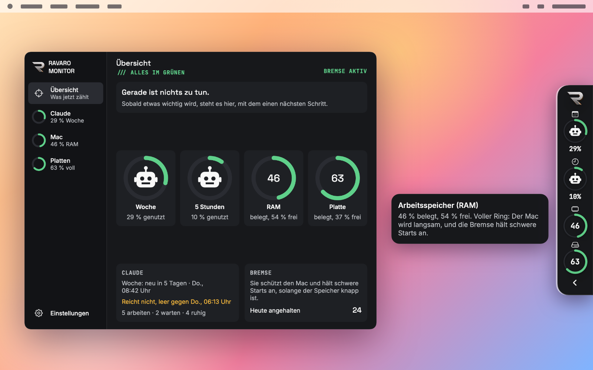
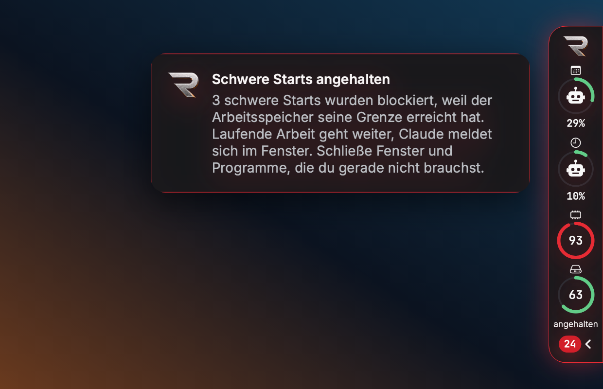
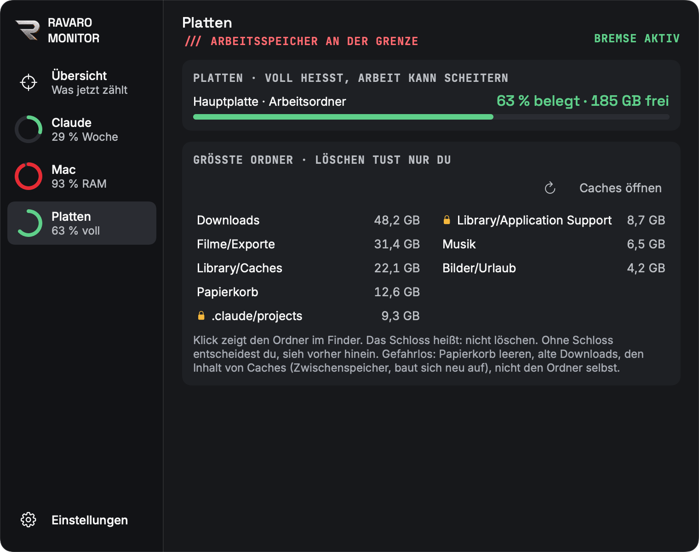
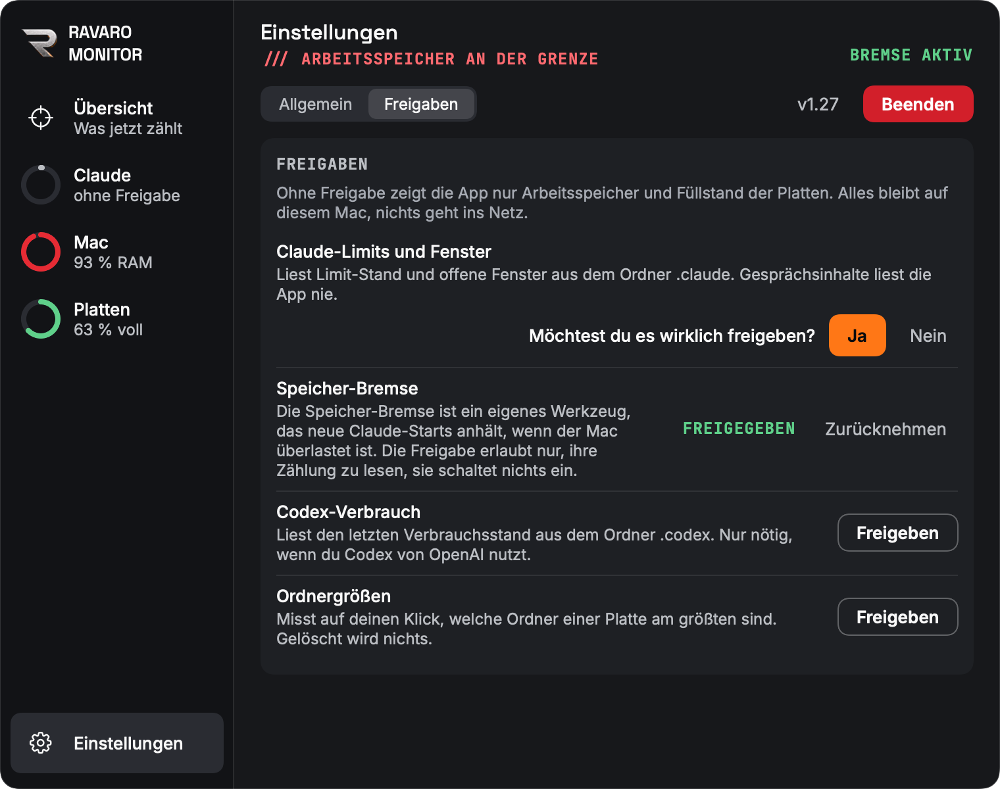
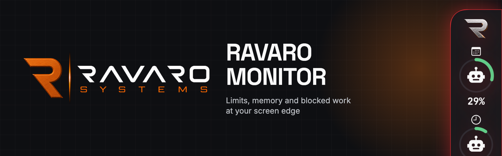
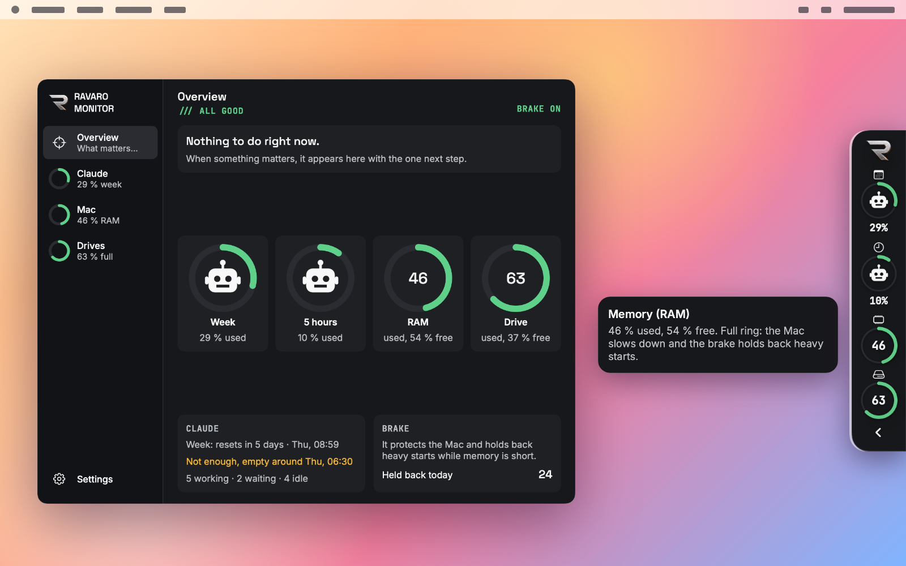
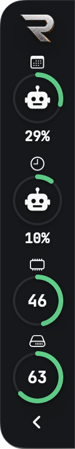
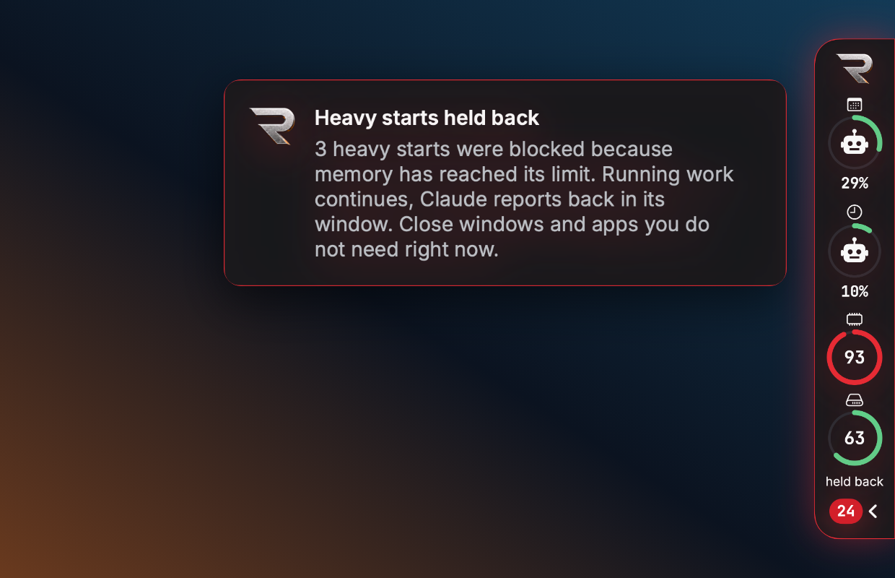
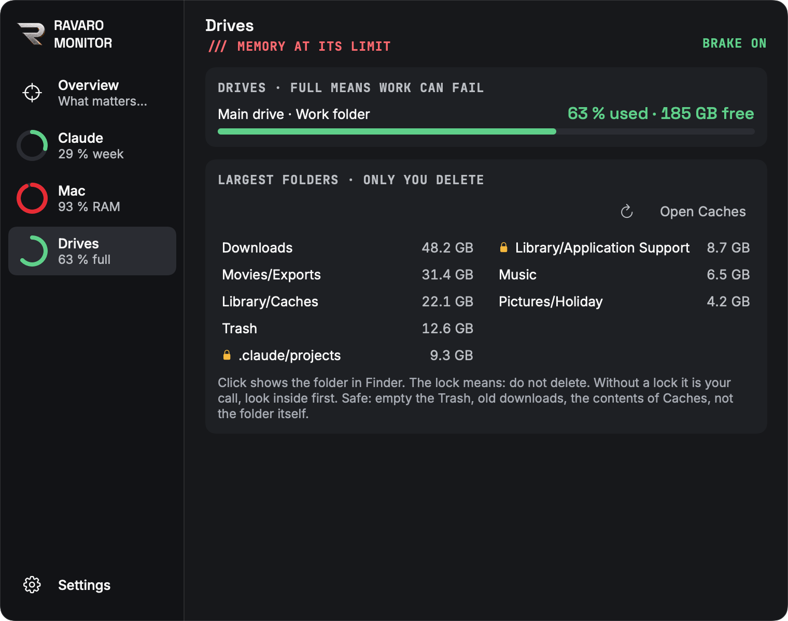
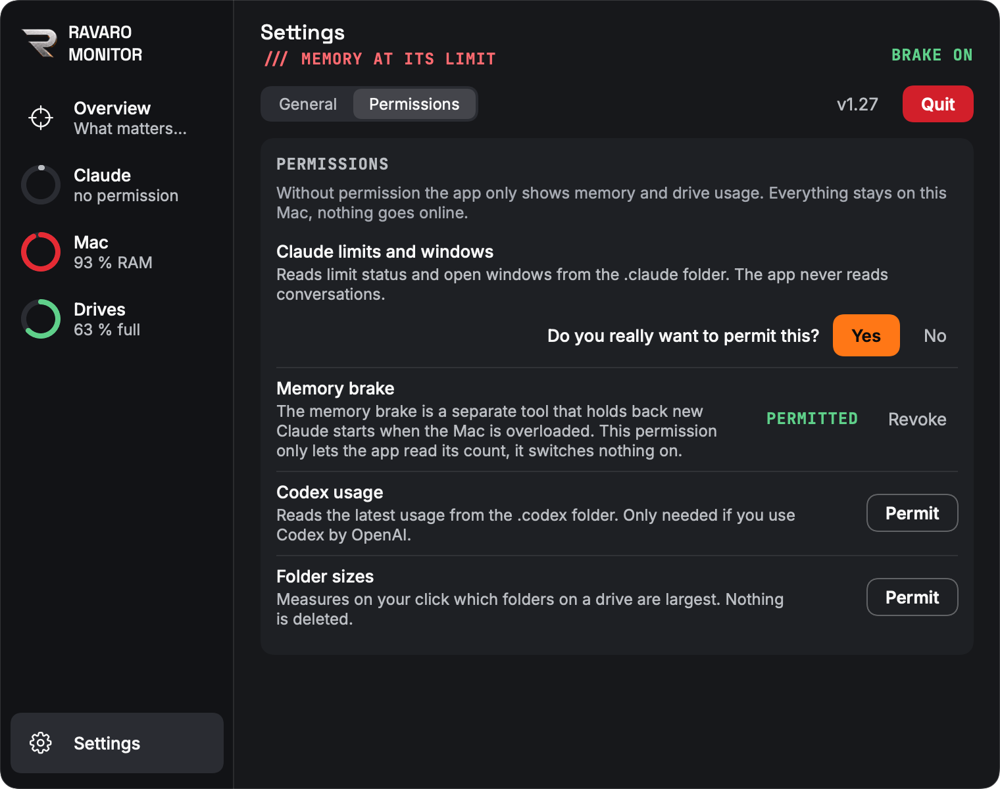

<div align="center">


</div>

# RAVARO Monitor

**v1.27** · Stand 2026-10-31 · Beschreibung mit Bildern neu geschrieben

**Du arbeitest mit Claude Code? Dann siehst du hier auf einen Blick, wann dein Limit endet, wann dein Mac an die Grenze kommt und was gerade blockiert wird.**

Eine kleine Mac-App als Lasche am Bildschirmrand. Kein Konto, kein Server, keine Verbindung ins Netz.



**[English version below](#english)**

## Warum es den Monitor gibt

Wir lassen viele Claude-Fenster gleichzeitig arbeiten. Damit der Mac dabei nicht abstürzt, läuft bei uns eine Speicher-Bremse: Wird der Arbeitsspeicher knapp, lehnt sie neue schwere Aufgaben ab.

Das hat sie zuverlässig getan, nur schrieb sie es in eine Datei, die niemand liest. In knapp drei Wochen kamen 138 Ablehnungen zusammen, 24 davon an einem Tag. Wir merkten nur, dass etwas nicht lief, und wussten nicht, warum. Dazu lagen 28 von 29 GB Gesprächsverläufen auf einer Platte, die zu 95 % voll war, und das stand nirgends.

Also haben wir uns etwas gebaut, das so etwas sofort zeigt, ohne dass man nachsehen muss.

## Was du siehst


**Die Lasche** sitzt links oder rechts am Rand und bleibt immer sichtbar. Die Regel ist einfach: **Ein voller Ring heißt, es wird eng.** Grün ist ruhig, gelb wird knapp, rot verlangt etwas von dir.

| Ring | Was er zeigt | Warum das hilft |
|---|---|---|
| Woche | Wie viel vom Wochenlimit verbraucht ist | Du siehst, ob es bis zum Neustart reicht |
| 5 Stunden | Dasselbe für das kurze Limit, abschaltbar | Kein Stillstand mitten in der Arbeit |
| RAM | Wie voll der Arbeitsspeicher ist | Du weißt, warum der Mac gerade zäh wird |
| Platte | Wie voll die Festplatte ist | Du merkst es, bevor nichts mehr geht |
| Akku | Ladung, am Strom grau mit Stecker, nur wenn ein Akku da ist | Einzige Ausnahme: Hier ist voll und grün gut |

Mit der Maus über einem Ring erklärt er sich selbst. Was du nicht brauchst, blendest du aus.

<br clear="right">

### Wenn etwas blockiert wird

Wird Arbeit angehalten, färbt sich die Lasche rot und zählt mit. Eine Mitteilung nennt die Zahl, und das Panel sagt dir, was du schließen kannst.



### Wenn du mehr wissen willst

Ein Klick klappt das Panel auf:

- **Claude:** Prognose, ob das Limit bis zum Neustart reicht, und welche Fenster arbeiten, warten oder ruhig sind.
- **Mac:** Was den Arbeitsspeicher belegt, mit lesbaren Namen, dazu der Akku.
- **Platten:** Die größten Ordner, ein Klick führt im Finder dorthin. Löschen tust nur du.
- **Codex:** Stand und Verbrauch, wenn du Codex benutzt.
- **Warnungen:** Ab 90 % eines Limits und bei knapper Platte, wenn du das möchtest.



## Was die App nicht tut

- Kein Login, kein Schlüsselbund, keine Verbindung ins Netz.
- Sie liest nur und löscht nie etwas, auch nicht in den Papierkorb.
- Sie fragt vorher: Beim ersten Start und danach je Funktion. Ohne dein Ja zeigt sie nur Arbeitsspeicher und Platten.



## Installieren

Du brauchst macOS 13 oder neuer und die Xcode Command Line Tools (`xcode-select --install`). Die App wird auf deinem Mac gebaut, das dauert ein paar Minuten.

```bash
git clone https://github.com/RRavaro/ravaro-monitor.git
cd ravaro-monitor
app/bau.sh
open ~/Applications/RAVARO\ Monitor.app
```

## Limits einrichten

Die Limits kommen aus der Statuszeile von Claude Code. Trage in `~/.claude/settings.json` ein, mit dem Pfad zu deinem Ordner:

```json
{ "statusLine": { "type": "command", "command": "bash /PFAD/ZU/ravaro-monitor/app/limits-statuszeile.sh" } }
```

Hast du schon eine eigene Statuszeile, ruf das Skript dort zusätzlich auf und gib ihm dieselben Daten weiter. Die Werte erscheinen nach der nächsten Antwort in einem Claude-Fenster.

Blockaden zählt die App nur zusammen mit einer Speicher-Bremse unter `~/.claude/hooks/speicher-bremse.py`. Ohne Bremse läuft alles andere genauso.

## Bedingungen

Der Quelltext ist öffentlich einsehbar, aber kein Open Source. Es gelten die Bedingungen in [LICENSE.md](LICENSE.md), Name und Logo bleiben Pflicht. RAVARO Monitor ist ein unabhängiges Werkzeug und stammt nicht von Anthropic oder OpenAI.

Gebaut von [RAVARO](https://ravaro.de).

---

## English

<div align="center">



</div>

**Working with Claude Code? See at a glance when your limit runs out, when your Mac hits its ceiling and what is being blocked right now.**

A small Mac app that sits as a tab on the edge of your screen. No account, no server, no network connection.



### Why it exists

We run many Claude windows at once. To keep the Mac from crashing, a memory brake refuses new heavy tasks when memory runs short.

It did that reliably, but it only wrote it to a file nobody reads. In under three weeks that added up to 138 refusals, 24 of them in a single day. All we noticed was that something did not run, and we did not know why. On top of that, 28 of 29 GB of conversation history sat on a drive that was 95 % full, and nothing showed it.

So we built something that shows this right away, without anyone having to go looking.

### What you see



**The tab** sits on the left or right edge and stays visible. The rule is simple: **a full ring means things are getting tight.** Green is calm, yellow is getting close, red needs you.

| Ring | What it shows | Why it helps |
|---|---|---|
| Week | How much of your weekly limit is used | You see whether it lasts until the reset |
| 5 hours | The same for the short limit, can be hidden | No standstill in the middle of your work |
| RAM | How full your memory is | You know why the Mac is getting slow |
| Drive | How full your drive is | You notice before nothing works anymore |
| Battery | Charge level, grey with a plug on power, only if your Mac has a battery | The one exception: here, full and green is good |

Hover over a ring and it explains itself. Whatever you do not need, you can hide.

<br clear="right">

#### When something is blocked

When work is held back, the tab turns red and counts. A notification gives the number, and the panel tells you what you can close.



#### When you want more detail

One click opens the panel:

- **Claude:** A forecast of whether your limit lasts until the reset, and which windows are working, waiting or idle.
- **Mac:** What is using your memory, with readable names, plus the battery.
- **Drives:** Your largest folders, one click takes you there in Finder. Only you delete anything.
- **Codex:** Status and usage, if you use Codex.
- **Warnings:** From 90 % of a limit and when a disk runs short, if you want them.



### What the app does not do

- No login, no keychain, no network connection.
- It only reads and never deletes anything, not even to the trash.
- It asks first: on first launch and then per feature. Without your yes it only shows memory and drives.



### Install

You need macOS 13 or later and the Xcode Command Line Tools (`xcode-select --install`). The app is built on your Mac, which takes a few minutes.

```bash
git clone https://github.com/RRavaro/ravaro-monitor.git
cd ravaro-monitor
app/bau.sh
open ~/Applications/RAVARO\ Monitor.app
```

The app speaks English and German. It follows your system language, and you can switch in the settings.

### Set up limits

The limits come from the Claude Code status line. Add this to `~/.claude/settings.json`, using the path to your folder:

```json
{ "statusLine": { "type": "command", "command": "bash /PATH/TO/ravaro-monitor/app/limits-statuszeile.sh" } }
```

If you already have a status line, call the script from it as well and pass the same input along. Values appear after the next reply in a Claude window.

Blocked work is only counted together with a memory brake at `~/.claude/hooks/speicher-bremse.py`. Everything else works without it.

### Terms

The source is public but not open source. [LICENSE.md](LICENSE.md) applies, name and logo must stay. RAVARO Monitor is an independent tool and does not come from Anthropic or OpenAI.

Built by [RAVARO](https://ravaro.de).
